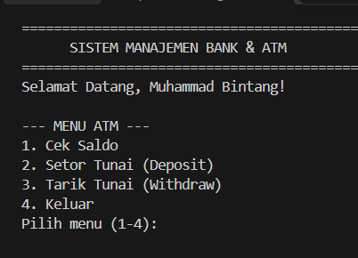
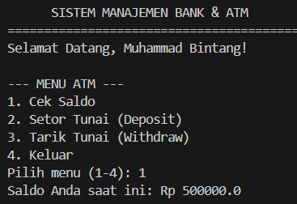
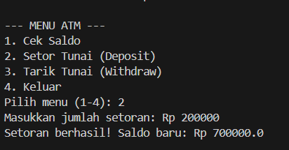
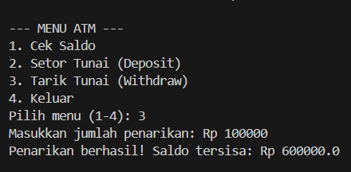
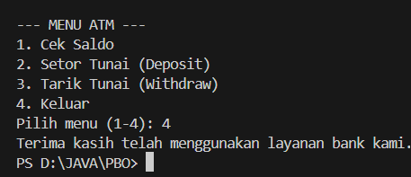

**NIM:** F1D0251024  
**Nama:** Muhammad Bintang Arifin  
**Kelas:** PBO 3D  

---

## Deskripsi Program
Program ini mengimplementasikan konsep pemodelan objek dengan relasi Agregasi antara `Bank`, `Customer`, dan `Account`. Dilengkapi dengan program interaktif menu ATM sederhana untuk mengeksplorasi pembuatan objek, pengelolaan saldo, setor tunai, serta tarik tunai.

---

## Output Program
| Fitur / Menu | Screenshot Output |
| :--- | :--- |
| **Menu Utama** |  |
| **Cek Saldo** |  |
| **Setor Tunai (Deposit)** |  |
| **Tarik Tunai (Withdraw)** |  |
| **Keluar** |  |